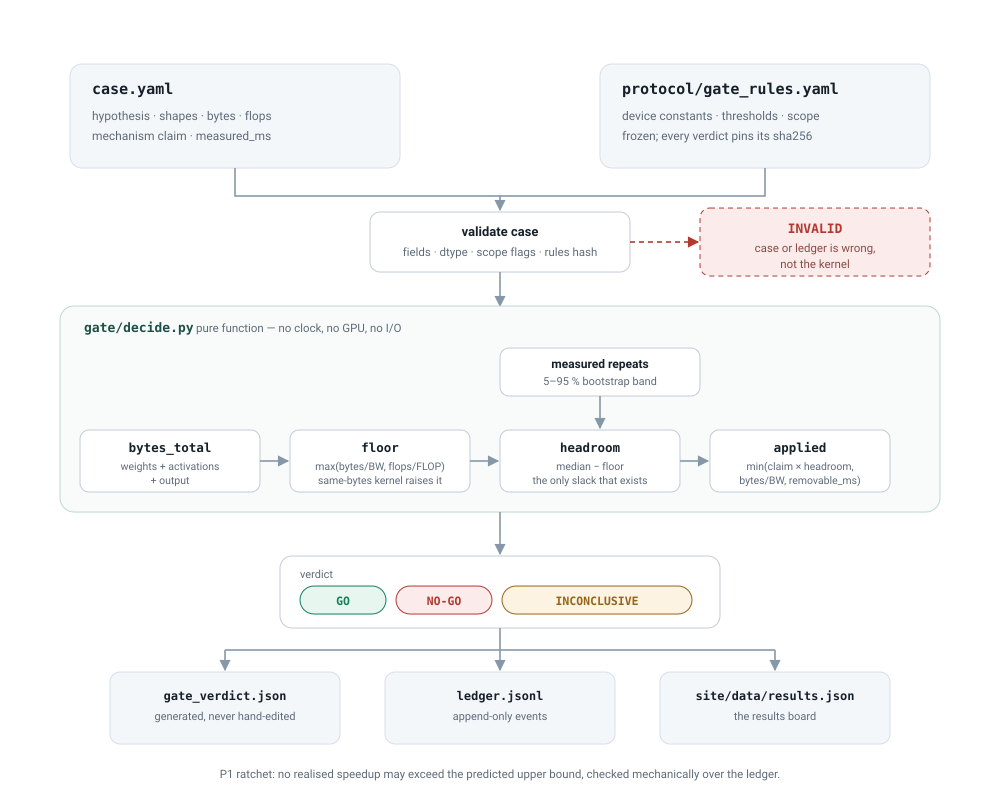

# Headroom-Gate Kernel RSI

**Work out the hardware ceiling before you write the kernel.**

Most kernel work only asks "how much faster than before", never "how much
headroom is left against the hardware". This project flips the order: work out
the lowest time the bytes and FLOPs allow (floor), then how much a rewrite could
possibly win (ceiling), and only then decide whether it is worth writing. GO if
the conservative estimate clears 1.3× — worth building. Under 1.15× is NO-GO. In
between is INCONCLUSIVE: an open question, not a failure.

One measured case on the AutoDL RTX 6000D replays its archived verdict on a
laptop with no GPU, because the gate is pure arithmetic over recorded
measurements. Five more cases ship as pre-registered templates with no
measurement data — they must be re-measured on third-party cloud hardware before
they can produce a verdict.

**English** · [简体中文](./README.zh-CN.md) · [Results board](https://sanyhe.github.io/headroom-gate-kernel-rsi/)

## How it fits together



A case and the frozen rules go in; a verdict comes out. Everything inside the
gate is arithmetic over numbers that were recorded beforehand, so the same inputs
give the same verdict on any machine, with or without a GPU. The one thing the
gate cannot do is measure — that happens once, on a cloud GPU, and lands in
`case.yaml` as `measured_ms`.

## The gate in one screen

1. **Bytes.** The bytes the workload must move (weights + activations + output)
   are summed. This number has no bargaining room.
2. **Floor.** `max(bytes / BW_eff, flops / FLOP_eff)` — 1.613 TB/s and 136.8
   TFLOPS on the AutoDL RTX 6000D host, both measured, not spec-sheet, frozen in
   `protocol/gate_rules.yaml`. An optional same-bytes reference kernel raises
   this floor and can never lower it.
3. **Headroom.** `measured_median - floor` is the only slack that exists.
4. **Addressable.** `min(claim × headroom, removable_bytes / BW, removable_ms)`.
   A mechanism cannot remove more time than the bytes or the time it touches.
5. **Band.** A 5–95 % bootstrap over the repeats. Kinks inside the band are
   evaluated explicitly: `speedup(t)` is non-monotonic once a cap binds.
6. **Verdict.** `GO` needs the conservative end at or above 1.30×, plus a
   same-bytes floor, at least 5 repeats and CV within 2%. `NO-GO` if even the
   generous end stays under 1.15×; everything else falls through.

```bash
python3 -m gate.cli --all
```

| Case | Verdict | Upper bound (5–95 %, point) | Why |
|---|---|---|---|
| `swiglu-fusion-b4096-h7168-rtx6000d` | **GO** | 2.147–2.155× (2.151×) | 176 MB stream fused to one pass on RTX 6000D; `torch.add` over the same bytes takes 0.108 ms |
| `swiglu-fusion-b4096-h7168` | pending | — | template: same design, awaiting third-party cloud measurement |
| `attn-decode-longctx` | pending | — | template: 128 MiB KV stream, awaiting measurement |
| `gemv-m8-bf16` | pending | — | template: 200 MiB weight stream, awaiting measurement |
| `selector-dflash2` | pending | — | template: selector fusion, awaiting measurement |
| `verify-fusion-megaspec` | pending | — | template: persistent verify-chain megakernel, awaiting measurement |

The published result is the one GO case measured on third-party cloud hardware.
The five templates are pre-registered designs with no measurement data; they show
the methodology and can be re-measured on any third-party cloud GPU.

## How the measured fusion works

The gate and `x[:, :H]` sit in one `[B, 2H]` bf16 buffer. The shipped PyTorch
path allocates a `[B, H]` intermediate and round-trips it through HBM; the fused
kernel reads the same input once and writes the output once.

```
shipped    x[B,2H] --silu--> tmp[B,H] 58.7 MB --mul--> y[B,H]
           2 launches  ·  read 234.8 MB  ·  write 117.4 MB  ·  0.235 ms

fused      x[B,2H] --silu_and_mul-----------------------> y[B,H]
           1 launch    ·  read 117.4 MB  ·  write  58.7 MB  ·  0.122 ms
```

Nothing is recomputed and nothing is approximated: the fused kernel is bitwise
identical to the shipped path, so the only change is 117.4 MB of traffic that
stops happening. At B=4096 the step is launch-bound, which is why the same
fusion measures 1.00x at model level (see [03](./docs/en/03-eval.md#6-second-host-a-boundary-condition-result)).

## Quickstart

```bash
./init.sh                                                # venv + replay + tests, no GPU
python3 -m gate.cli cases-rtx/swiglu-fusion-b4096-h7168-rtx6000d  # one measured case -> verdict
python3 -m gate.cli --all --record                       # append verdicts to ledger.jsonl
python3 -m gate.cli --verify-ledger                      # claim P1: realised <= predicted
```

Requirements: Python 3.10+, `PyYAML`, `pytest`. Nothing else.

## What the verdicts guarantee

- **P1 — ratchet.** No realised speedup may exceed the predicted upper bound.
  Checked mechanically over `ledger.jsonl`.
- **P2 — disjointness.** Evaluation operators never appear in measured cases.
  Enforced by construction; the sealed runner has landed and ran on the second
  host, with a post-hoc freeze noted in 03.
- **Provable scope.** `out_of_scope_checks` (precision, model, acceptance,
  output distribution) invalidate a case rather than being argued about.
- **Reproducible identity.** Every verdict embeds the sha256 of
  `protocol/gate_rules.yaml`; drift is detected, not discussed.

## Status: what runs where

Implemented and verified locally (no GPU):

| Area | Where |
|---|---|
| Frozen rules + hash check | `protocol/gate_rules.yaml`, `gate/rules.py` |
| Byte/FLOP ledger, roofline, empirical-floor fold | `gate/byte_model.py` |
| Decision logic, kink-aware bounds | `gate/decide.py` |
| Bootstrap / parametric bands, paired tests | `stats/bootstrap.py` |
| Append-only ledger + P1 ratchet | `gate/ledger.py` |
| CLI + verdict artifacts | `gate/cli.py` |
| Five pre-registered case templates | `cases/*/case.yaml` |
| One measured case (RTX 6000D) | `cases-rtx/*/case.yaml` |
| Detached-run contract (detach / status / stop / resume) | `scripts/` |
| Frozen P3 policy + selection | `p3/policy.md`, `p3/select.py` |
| 71 CPU tests | `tests/` |

Measured on the AutoDL RTX 6000D host (third-party cloud): the operator reaches
1.92× (Triton) and 2.12× (CUDA) with bit-identical output, the held-out shapes
hold at 1.88× / 1.30× / 1.72×, and the P1 ratchet is intact. At model level the
same fusion is 1.00×: a 4096-token prefill is launch-bound, so 8.3 ms of saved
activation GPU time does not move the 506 ms step. That is the published boundary
condition — see [03 — Evaluation](./docs/en/03-eval.md#6-second-host-a-boundary-condition-result).
Still pending: a registered P3 selection (exploratory timings exist; the pool has
no accuracy trials).

The measured case's verdict is replayed from the recorded `measured_ms` in its
`case.yaml`, not re-measured. Every sample used is embedded in the case file; the
raw evidence lives under `cases-rtx/<id>/evidence/`. `case.yaml` is append-only;
see [`docs/02-measurement.md`](./docs/02-measurement.md). The five template cases
in `cases/` carry no `measured_ms` and produce no verdict until re-measured on
third-party cloud hardware.

## Layout

```
protocol/gate_rules.yaml   frozen thresholds, device constants, scope
gate/                      byte model, decide, ledger, CLI, device probes
stats/bootstrap.py         median CI, parametric band, paired bootstrap
cases/<id>/case.yaml       pre-registered template: hypothesis, bytes, no measurements
cases-rtx/<id>/case.yaml   measured case with recorded samples
cases-rtx/<id>/gate_verdict.json  generated; never hand-edited
p3/                        frozen selection policy + deterministic selector
scripts/                   detached-run contract (status.json is the truth)
docs/                      method, measurement, evaluation, P3
private/                   harness state (gitignored)
```

## Docs

- [01 — The gate](./docs/en/01-gate.md): ledger, floor, caps, band, verdicts.
- [02 — Measurement](./docs/en/02-measurement.md): timing protocol and the
  detached-run contract.
- [03 — Evaluation](./docs/en/03-eval.md): P1/P2, the measured RTX 6000D case,
  the boundary condition, and the one honest deviation in this repo.
- [04 — P3](./docs/en/04-p3.md): pre-registered selection and the joint-impact rule.

## License

Apache-2.0. See [LICENSE](./LICENSE).
