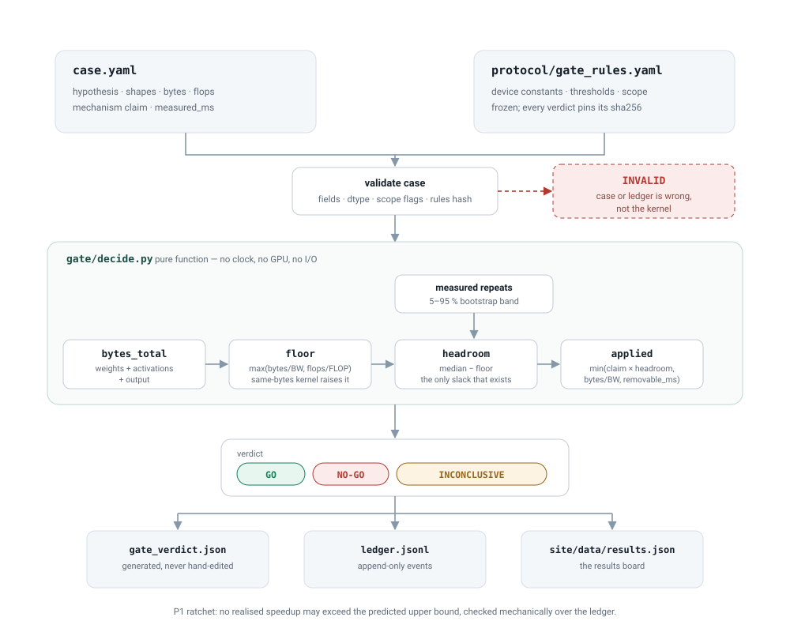

# Headroom-Gate Kernel RSI

**先算硬件上限，再决定要不要写Kernel。**

多数Kernel优化只问"比原来快多少"，不问"离硬件天花板还剩多少余量"。这个项目反过来：先算带宽和算力决定的耗时下限（floor），再算这次改写最多能拿到多少（ceiling），然后才决定值不值得动手。保守估计加速 ≥1.3× 才 GO，值得做；<1.15× 是 NO-GO，不要做；中间是 INCONCLUSIVE——结果存疑，不是失败。

一个在 AutoDL RTX 6000D 上实测的案例，可以在没有 GPU 的笔记本上复算出归档判决，因为闸门只是对已记录测量做的纯算术。另有五个案例作为预注册模板发布，不含测量数据，须在三方云 GPU 上重新测量后才能产生判决。

[English](./README.md) · **简体中文** · [结果看板](https://sanyhe.github.io/headroom-gate-kernel-rsi/)

## 整体结构



输入是一个案例加一份冻结的规则，输出是一个判决。闸门内部只对事先记录好的数字做算术，所以同样的输入在任何机器上都得到同样的判决，有没有 GPU 都一样。闸门唯一做不到的是测量——测量只在云 GPU 上发生一次，结果以 `measured_ms` 落回 `case.yaml`。

## 一屏看懂闸门

1. **必经字节。** 汇总工作负载的必经流量（权重 + 激活 + 输出），这一项没有讨价还价的余地。
2. **地板。** `max(bytes / BW_eff, flops / FLOP_eff)`；AutoDL RTX 6000D 主机上 1.613 TB/s 与 136.8 TFLOPS 都是实测值，不是规格表，冻结在 `protocol/gate_rules.yaml`。可选的同字节参考 Kernel 只能抬高地板，不能压低。
3. **余量。** `实测中位数 - 地板` 是唯一存在的改进空间。
4. **可兑现空间。** `min(声称比例 × 余量, 可移除字节 / BW, 可移除毫秒)`。机制移除的时间不能超过它实际覆盖到的字节或时间。
5. **区间。** 对重复样本做 5–95% bootstrap。区间内出现拐点会显式求值：一旦上限生效，`speedup(t)` 不再单调。
6. **判决。** `GO` 需保守端 ≥1.30×，并且有同字节实测地板、≥5 次重复、CV ≤2%。宽松端都到不了 1.15× 则 `NO-GO`；其余情况落到 `INCONCLUSIVE`。

```bash
python3 -m gate.cli --all
```

| 案例 | 判决 | 上限（5–95%，点估计） | 原因 |
|---|---|---|---|
| `swiglu-fusion-b4096-h7168-rtx6000d` | **GO** | 2.147–2.155×（2.151×） | 176 MB 流式读写在 RTX 6000D 上融合为一遍；同样字节的 `torch.add` 只要 0.108 ms |
| `swiglu-fusion-b4096-h7168` | 待测量 | — | 模板：相同设计，等待三方云测量 |
| `attn-decode-longctx` | 待测量 | — | 模板：128 MiB KV 流，等待测量 |
| `gemv-m8-bf16` | 待测量 | — | 模板：200 MiB 权重流，等待测量 |
| `selector-dflash2` | 待测量 | — | 模板：选择器融合，等待测量 |
| `verify-fusion-megaspec` | 待测量 | — | 模板：持久化验证链 megakernel，等待测量 |

对外发布的是在三方云硬件上实测的 GO 案例。五个模板是预注册的设计，不含测量数据，用于展示方法论，可在任意三方云 GPU 上重新测量。

## 实测的融合做了什么

gate 和 up 两块数据本来就在同一个 `[B, 2H]` bf16 buffer 里。PyTorch 的默认写法会额外分配一块 `[B, H]` 中间结果，并让它往返一次 HBM；融合 Kernel 把同一份输入读一遍、输出写一遍。

```
默认写法   x[B,2H] --silu--> tmp[B,H] 58.7 MB --mul--> y[B,H]
           2 次发射  ·  读 234.8 MB  ·  写 117.4 MB  ·  0.235 ms

融合写法   x[B,2H] --silu_and_mul-----------------------> y[B,H]
           1 次发射  ·  读 117.4 MB  ·  写  58.7 MB  ·  0.122 ms
```

没有重算，也没有近似：融合 Kernel 与默认写法逐位一致，唯一的变化是那 117.4 MB 不再发生。在 B=4096 时这一步是发射受限的，所以同一融合在模型层只测到 1.00×（见 [03](./docs/03-eval.md#6-第二台主机一个边界条件结果)）。

## 快速开始

```bash
./init.sh                                                          # 建 venv、复算判决、跑测试，无需 GPU
python3 -m gate.cli cases-rtx/swiglu-fusion-b4096-h7168-rtx6000d   # 单实测案例 -> gate_verdict.json
python3 -m gate.cli --all --record                                 # 判决写入 ledger.jsonl
python3 -m gate.cli --verify-ledger                                # 主张 P1：realised <= predicted
```

依赖：Python 3.10+、`PyYAML`、`pytest`，没有别的。

## 判决承诺什么

- **P1 棘轮。** 任何实测加速不得超过预测上限；由 `ledger.jsonl` 机械检查。
- **P2 不相交。** 评估算子不出现在测量案例里；按构造保证。封存运行器已落地并在第二台主机上运行过，事后冻结已注明。
- **范围可证。** `out_of_scope_checks`（精度、模型、接受率、输出分布）触发即判 `INVALID`，不进行口头讨论。
- **身份可复现。** 每个判决内嵌 `protocol/gate_rules.yaml` 的 sha256；漂移会被发现，而不是被讨论。

## 当前状态：哪些能跑

本地已实现并验证（无需 GPU）：

| 模块 | 位置 |
|---|---|
| 冻结规则 + 哈希校验 | `protocol/gate_rules.yaml`、`gate/rules.py` |
| 字节/FLOP 账本、roofline、经验地板折叠 | `gate/byte_model.py` |
| 判决逻辑、拐点感知的上下界 | `gate/decide.py` |
| bootstrap / 参数化区间、配对检验 | `stats/bootstrap.py` |
| 追加式账本 + P1 棘轮 | `gate/ledger.py` |
| CLI 与判决产物 | `gate/cli.py` |
| 五个预注册案例模板 | `cases/*/case.yaml` |
| 一个实测案例（RTX 6000D） | `cases-rtx/*/case.yaml` |
| 后台运行契约（detach / status / stop / resume） | `scripts/` |
| 冻结的 P3 策略与确定性选择器 | `p3/policy.md`、`p3/select.py` |
| 71 个 CPU 测试 | `tests/` |

在 AutoDL RTX 6000D 主机（三方云）上实测：算子层 Triton 1.92×、CUDA 2.12×，输出逐位一致；
留出形状保持 1.88× / 1.30× / 1.72×；P1 棘轮未违规。模型层同一融合约为 1.00×：
4096 token 的 prefill 是发射受限的，省下的 8.3 ms 激活 GPU 时间不会改变 506 ms 的一步。
这就是对外发布的边界条件——见 [03 — 评估](./docs/03-eval.md#6-第二台主机一个边界条件结果)。
仍待完成：注册过的 P3 选择（已有探索性计时；池中没有精度 trial）。

实测案例的判决是从其 `case.yaml` 里记录的 `measured_ms` 复算出来的，没有重新测量。
所用样本全部内嵌在案例文件中；原始证据位于 `cases-rtx/<id>/evidence/`。`case.yaml` 只追加、不改写；
见 [`docs/02-measurement.md`](./docs/02-measurement.md)。`cases/` 下的五个模板案例不含
`measured_ms`，在三方云硬件上重新测量前不产生判决。

## 目录

```
protocol/gate_rules.yaml   冻结阈值、设备常数、范围
gate/                      字节模型、判决、账本、CLI、设备探针
stats/bootstrap.py         中位数 CI、参数化区间、配对 bootstrap
cases/<id>/case.yaml       预注册模板：假设、字节数，无测量
cases-rtx/<id>/case.yaml   实测案例，含记录的样本
cases-rtx/<id>/gate_verdict.json  生成物，不手改
p3/                        冻结选择策略 + 确定性选择器
scripts/                   后台运行契约（以 status.json 为准）
docs/                      方法、测量、评估、P3
private/                   harness 状态（gitignore）
```

## 文档

- [01 — 闸门](./docs/01-gate.md)：账本、地板、三重约束、区间、判决。
- [02 — 测量](./docs/02-measurement.md)：计时协议与后台运行契约。
- [03 — 评估](./docs/03-eval.md)：P1/P2、RTX 6000D 实测案例、边界条件，以及本仓库唯一一处诚实的偏差。
- [04 — P3](./docs/04-p3.md)：预注册选择与联合影响规则。

## 许可

Apache-2.0，见 [LICENSE](./LICENSE)。
